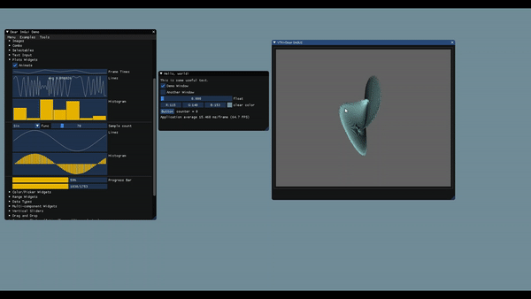

# imgui-vtk
- Incorporate VTK's dataset visualization capabilities with versatility of Dear ImGui
  - Multiple independent `VtkViewer` instances can be used in the same program to display multiple VTK scenes simultaneously
- Uses VTK's OpenGLRenderWindow class
  - Renders to texture and displays the texture natively with ImGui
- Compatible with both ImGui's `main` and `docking` branches



## Layout
- `include/VtkViewer.h`, `src/VtkViewer.cpp`: the viewer class
- `example/`: demo application
- `CMakeLists-alt.txt`: alternative single-target build that compiles everything from source

## Usage:
- Build
  - On the first configure, Python 3 (`python3` or `python`) and network access are required: `gl3w/src/gl3w.c` is generated by `gl3w_gen.py`, which downloads `glcorearb.h`
  - `git submodule update --init --recursive`
  - `cmake -B build -S .`
  - `cmake --build build --config Release`
- CMake
  1. Build separately & link
    - Build your executable, imgui, your OpenGL Loader (e.g., gl3w), and imgui-vtk. **Make sure to link imgui-vtk against imgui, your OpenGL Loader (e.g., gl3w), and VTK!**
    - See `CMakeLists.txt` for more details
  2. Build together
    - Build your executable, imgui, your OpenGL Loader (e.g., gl3w), and imgui-vtk all together, from source.
    - See `CMakeLists-alt.txt` for more details
- See `example/main.cpp`

### Using the installed package
- `imgui-vtk` installs `include/VtkViewer.h`, a static library, and a CMake package config.
- Consumers must provide imgui, glfw3, gl3w, and VTK as CMake packages (vcpkg provides all of them).

```cmake
find_package(imgui-vtk CONFIG REQUIRED)
target_link_libraries(app PRIVATE imgui-vtk::imgui_vtk)
imgui_vtk_autoinit(app) # required when VTK is built statically
```

## Build with vcpkg
`vcpkg.json` pins imgui, glfw3, gl3w, and VTK, so the git submodules are not needed. With `VCPKG_ROOT` pointing at a vcpkg checkout:

```sh
cmake -B build -S . -DCMAKE_TOOLCHAIN_FILE="$VCPKG_ROOT/scripts/buildsystems/vcpkg.cmake"
cmake --build build --config Release
```

The first configure builds the pinned VTK port, which takes a while. The manifest also enables imgui's `docking-experimental` feature, which the example requires. The default submodule-based build above is unchanged; `CMakeLists.txt` only takes the package path when configured with the vcpkg toolchain.

## Notes
- `imgui`, `gl3w`, and `glfw` are included in this repository as git submodules
  - For integration into an existing project, only `include/VtkViewer.h` and `src/VtkViewer.cpp` are needed. However, they will need to be linked with or built alongside Dear ImGui and VTK
- Dependencies are built separately in `CMakeLists.txt` then linked together as static libraries
  - `CMakeLists-alt.txt` builds everything together from source
- Usage (see [`example/main.cpp`](example/main.cpp) for details)
  - You must create and end ImGui windows yourself
    - Allows for other widgets to be placed in the same ImGui window as the VTK "viewport"
    - Allows for full control over window size, behavior, etc. via Dear ImGui API
- **Note: For the sake of cleanliness and readability, most ImGui preprocessor directives were removed.** Files no longer auto-detect your OpenGL loader. While everything is currently set up for OpenGL3 + GLFW + GL3W, you may need to adjust `#include` statements, etc. to match your use case.
